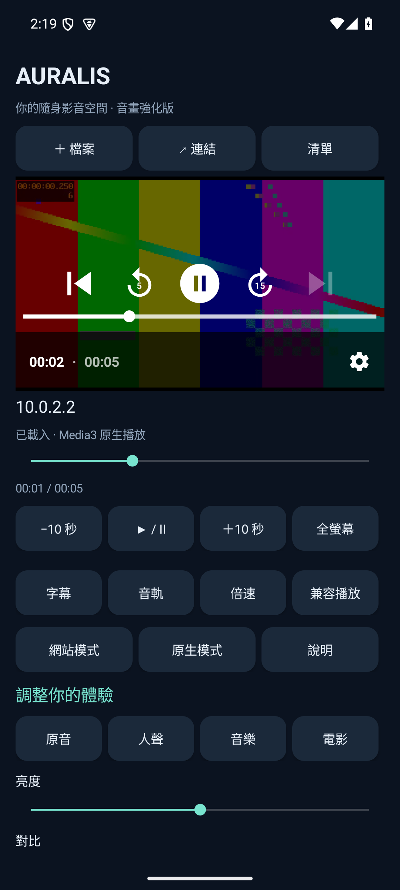
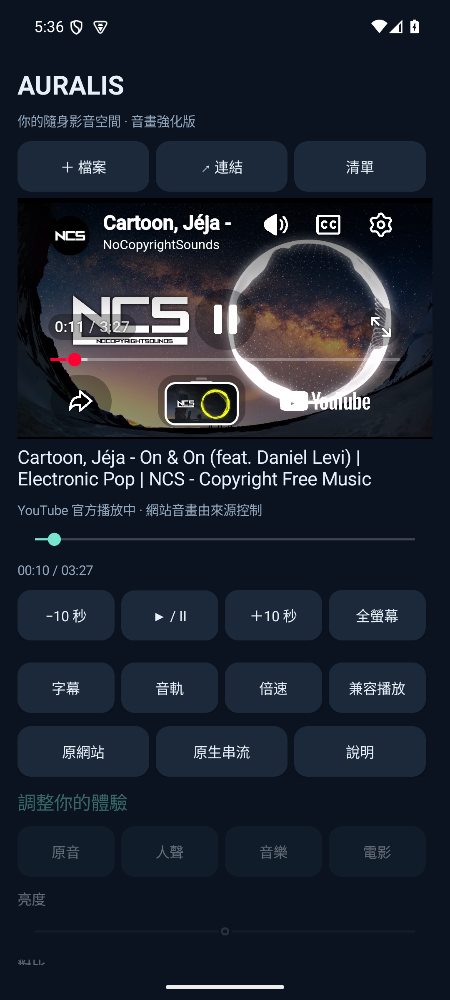

# Auralis Android

繁體中文 Android 手機影音播放器。1.1.0 修正 YouTube／YouTube Music 播放，預設在 App 內使用官方播放器。提供 Lite 精簡版與 Full 強化版，各有 ARM64、ARMv7、x86_64 和通用 APK。Android 8.0（API 26）起可安裝；本次在 Android 15 模擬器驗證，手機實機與其他 Android 版本仍需測試。

| 功能 | Lite 精簡版 | Full 強化版 |
|---|---|---|
| 本機檔案、SAF 系統檔案選擇、多項播放清單 | ✓ | ✓ |
| 直接媒體、HLS／DASH／RTSP、倍速、跳轉、SRT 字幕、多音軌 | ✓ | ✓ |
| YouTube／YouTube Music App 內官方播放器 | ✓ | ✓ |
| 嗶哩嗶哩等原網站模式 | ✓ | ✓ |
| 網站連結解析為原生串流 | — | yt-dlp；視網站限制而定 |
| VLC 兼容解碼 | — | ✓ |
| 原音、人聲、音樂、電影等化器風格 | — | ✓ |
| 原生播放亮度、對比、飽和度 | — | ✓ |
| DLSS 5／RTX VSR／AI 插幀 | — | — |

Media3 使用 Android 支援的解碼器；Full 的 VLC 兼容模式提供更多軟件解碼格式。不保證每種檔案、編碼或裝置均可播放。Full 的畫面調整適用於 Media3 原生模式，音效亦支援 VLC；網站播放時音畫調整停用，由網站本身控制。

貼上 YouTube 或 YouTube Music 單曲連結後，App 內官方播放器可播放／暫停、跳轉及調速，保留官方控制與廣告；Music 單曲播放不等於完整 Music 訂閱功能。Full 的「原生串流」另行嘗試 yt-dlp，失敗時回到官方播放器；「原網站」在 App 內開啟來源頁面。登入、地域、DRM、付費或禁止嵌入的影片仍受網站限制。此更新驗證公開 YouTube／Music 範例，沒有宣稱所有登入內容或嗶哩嗶哩影片均可播放。

下載：[Releases](https://github.com/sion-rgb/auralis-android/releases)。一般新手機選 `arm64-v8a`；舊款 32 位手機選 `armeabi-v7a`；不確定選 `universal`。Lite 和 Full 的套件名稱不同，可同時安裝。APK 為開發者本機發佈金鑰簽署，不是 Google Play 商店版本。





## 技術選擇

Java／AndroidX 原生介面和 Media3 負責手機生命週期、檔案授權、播放與 GPU 畫面效果；Full 可切換至 LibVLC。Rust 共用來源驗證與等化器預設，透過小型 C++ JNI 橋接。這個 Rust 核心亦供獨立 Windows 播放器使用。Rust 不負責影片解碼，C++ 橋接不宣稱提供 DLSS；Android 不載入 Windows 的 NVIDIA 運行庫。

## 建置

需要 JDK 17+、Android SDK 36、NDK 28.2.13676358、CMake 3.22.1 與 Rust。SDK 路徑放在個人的 `local.properties` 或 `ANDROID_SDK_ROOT`，不要提交。

Windows：

```powershell
pwsh -File scripts/build-native.ps1
./gradlew.bat lintLiteRelease lintFullRelease assembleLiteRelease assembleFullRelease
```

Linux：

```bash
bash scripts/build-native.sh
./gradlew lintLiteRelease lintFullRelease assembleLiteRelease assembleFullRelease
```

Gradle 產生的 release APK 尚未簽署。使用自己的發佈金鑰及 Android SDK `zipalign`／`apksigner` 簽署；本機金鑰、密碼及 Cookie 檔不得提交。更新已安裝 APK 需要相同簽署金鑰。發佈者保留本機金鑰，GitHub 不含私鑰。

## 驗證與限制

驗證記錄放在 `docs/verification.md`。原生測試會讀取實際渲染緩衝區及播放時間；測試使用 localhost 媒體伺服器，不會存取私人影音。支持最低 Android 版本是建置設定，不代表已在每個版本或實機測試。

## 隱私與授權

見 [PRIVACY.md](PRIVACY.md) 及 [THIRD_PARTY.md](THIRD_PARTY.md)。App 為 GPL-3.0-or-later；Rust 共用核心為 MIT。YouTube、嗶哩嗶哩、VLC 等名称與商標屬各自權利人，本專案沒有其認可或聯繫。
